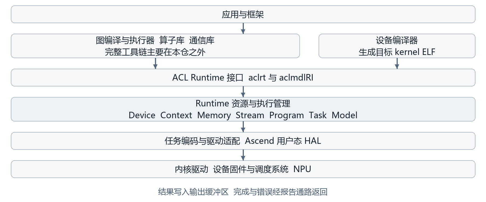
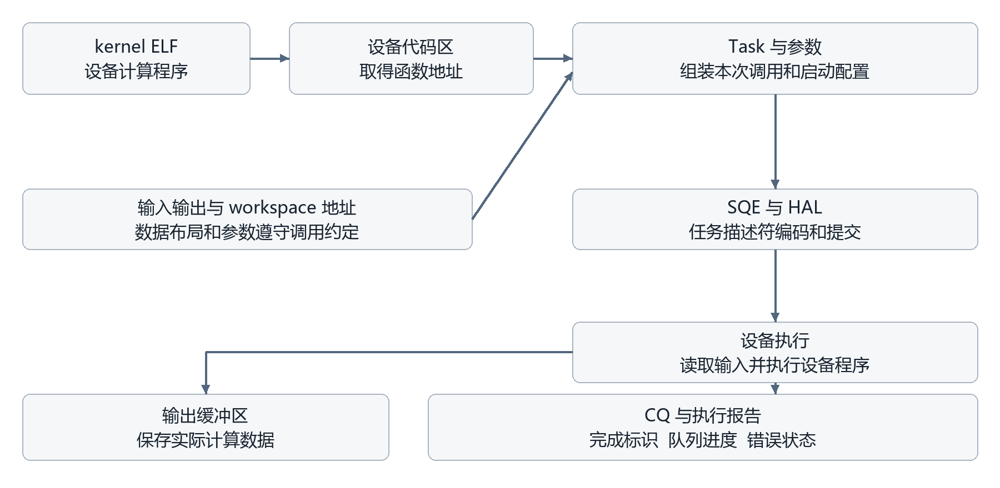

# 华为昇腾 Runtime 技术调研报告

云端 NPU 运行时架构及其与端侧运行时的比较

调研日期 2026年11月2日

研究对象 Learn-Compiler/runtime-mirror 仓库 master 分支

源码基线 f1030c42a414fb00e87dd689225997048364e3b7

## 摘要

NPU 编译器生成设备程序后，应用还需要完成程序加载、内存准备、执行依赖组织、任务提交和结果同步。Runtime 承担这部分工作，决定编译结果能否在实际设备资源和并发条件下正确执行。对于云端大芯片，Runtime 还需要控制高频任务提交的开销，协调计算与数据传输，并提供异步执行中的故障定位能力。

本报告以华为 CANN Runtime 开源仓库为主要研究对象，分析其功能定位、执行机制、编译器接口、驱动接口及输入输出形式，并与端侧 NPU 软件栈进行比较。调研表明，该仓库的主体是面向昇腾设备的执行基础设施，主要管理设备与上下文、内存与数据传输、Stream 与同步对象、kernel 程序、执行任务及运行时图，同时包含性能采集、数据 Dump 和日志等支撑能力。[1] [2]

其上下游关系可以概括为：上层编译器和算子执行器提供设备代码、调用参数、内存需求与执行依赖，Runtime 将这些信息落实为设备资源和任务；底层通过 Ascend 用户态 HAL 接收内存与队列请求、任务描述符，并返回执行报告。编译器、Runtime 与驱动之间需要对齐的是完整的执行约定，文件后缀只是其中一个方面。

输入输出需要按软件层次分别理解。完整 CANN 模型部署通路可使用 OM 离线模型；本仓核心 kernel 加载通路处理目标设备二进制，典型形式为 ELF kernel 文件或内存中的 ELF 数据；运行时图可由 API 调用构建或捕获；计算结果通常保存在输出 tensor 对应的内存缓冲区中。SQE 是提交任务的描述符，CQ/report 是完成和错误信息，二者均不能直接等同于模型文件或输出 tensor。[3] [4] [5] [6]

云端与端侧 Runtime 具有相同的基本执行责任，差异主要来自内存拓扑、资源规模、功耗约束、操作系统环境及工作负载。云端设计通常更强调并发、吞吐和可观测性；端侧设计通常更重视资源占用、启动成本及能耗。上述区别属于典型工程取向，具体产品仍需依据硬件和软件版本判断。

## 1 调研目标与研究范围

### 1.1 调研目标

本调研旨在建立对昇腾 Runtime 的系统认识，回答五个问题：该仓库在 NPU 软件栈中处于什么位置；代码提供哪些主要能力；上层编译器如何把执行产物交给 Runtime；Runtime 如何调用驱动并处理执行完成；云端大芯片与端侧 NPU 的 Runtime 有哪些共同机制和设计差异。

对输入输出的讨论同时覆盖程序产物和计算数据。程序产物包括离线模型、kernel 二进制及任务图；计算数据包括输入 tensor、workspace、tiling 数据和输出 buffer。区分两者，有助于判断一个接口究竟承担模型解析、设备代码装载，还是计算执行。

### 1.2 研究对象与方法

源码分析固定在 master 分支提交 f1030c42a414fb00e87dd689225997048364e3b7，避免后续分支更新改变结论。研究结合仓库构建入口、对外接口、核心执行实现、设计文档和样例，通过交叉核对确认模块责任和关键数据流。华为官方资料用于补充完整 CANN 的模型部署边界；Google、PyTorch 和 Arm 官方资料用于说明端侧软件栈的代表性实现。

本报告将代码中可直接确认的事实与架构归纳分开。涉及具体函数、二进制解析和 HAL 调用的结论以该提交为准；云端与端侧的比较属于基于公开实现的技术分析。研究未包含真实 NPU 的性能测量，因而不对吞吐、延迟、能耗或某型号的完整支持矩阵作定量评价。

## 2 NPU Runtime 的技术定位

### 2.1 从编译结果到设备执行

编译器主要解决计算如何转换为目标设备可执行程序的问题。即使设备程序已经生成，运行时仍然存在需要动态处理的条件：当前进程使用哪个设备、可用内存在哪里、参数地址是什么、哪些操作需要等待前序任务、队列是否还有空间，以及设备执行是否已经结束。这些条件在编译阶段通常无法全部确定，因此需要 Runtime 在执行阶段管理。

以一次向量加法为例，编译器生成加法 kernel 的设备指令；应用准备输入数据；Runtime 分配设备缓冲区、加载代码、组织参数并提交任务；设备执行后将结果写入输出地址；Runtime 在同步点报告完成状态。该过程说明，设备程序、任务启动信息和 tensor 存储是相互关联的不同对象。[7] [8] [9]

在云端服务器中，Runtime 通常作为用户态库进入应用进程。这里的“云端”描述设备的部署和工作负载，并不意味着 Runtime API 本身就是远程服务接口。集群调度、模型服务和网络协议可以构建在其上层，但不属于本仓核心执行接口的同一职责。[2]

### 2.2 编译器与 Runtime 之间的职责划分

编译器及其相邻的图引擎、算子工具链，负责把模型语义降低到设备程序和执行计划。相关决策可能包括算子实现选择、融合、数据布局、切分策略、workspace 大小以及 kernel 的启动配置。Runtime 接收已经足够接近执行层的描述，再将其映射到进程和设备资源。

这一边界在不同软件栈中并不完全相同。某些模型级 Runtime 同时包含图解析、分区和在线编译；某些低层 Runtime 则只暴露程序加载、buffer 和任务接口。因此，调研中需要先确定被比较的组件层级，不能把名称中都含有 Runtime 的产品视为同等范围。

### 2.3 Runtime 与驱动之间的职责划分

Runtime 管理应用可见的执行对象和任务生命周期，驱动栈提供设备访问、地址与内存服务、队列资源和执行通知。二者之间通常还有用户态 HAL，用于封装具体平台接口。

本仓的驱动适配代码可见 halMemAlloc、halSqCqAllocate、halSqTaskSend 和 halCqReportRecv 等调用。它们证明了 Runtime 向下传递的主要是地址、资源参数和任务描述符。更底层的设备节点、ioctl、通知和中断实现，需要结合对应驱动与固件研究，不能仅由 Runtime 的 HAL 调用点完整推导。[5] [10] [11] [12]

## 3 华为 CANN Runtime 的总体架构

### 3.1 在 CANN 软件栈中的位置

从本仓接口和构建结构看，CANN Runtime 位于框架、算子执行器、图引擎等上层组件与 Ascend 驱动栈之间。对外主要提供 aclrt 类运行时接口、aclmdlRI 类运行时模型接口，以及相关底层 rt/rts 接口。内部围绕资源管理、程序管理和任务执行组织实现。[2] [13]

图1 昇腾 Runtime 的软件栈位置与执行边界

传统 CANN 离线模型、设备 kernel 和 Runtime Model 分别处于不同抽象层。OM 是模型部署产物；kernel 是设备执行程序；Runtime Model 是执行任务与 stream 的组织形式。在本次源码基线中，传统 acl_mdl.h 是兼容占位文件，完整传统模型接口需要配套软件包提供。因此，该开源仓库适合研究执行基础设施，其代码范围不能直接扩展为完整 ATC 或 OM 模型解析系统。[3] [14] [15]

### 3.2 主要功能体系

资源管理构成运行时的基础。设备模块负责设备初始化、能力查询、状态与资源生命周期；Context 组织设备上的执行上下文；内存模块负责 Host 与 Device 内存及相应拷贝、映射和共享。应用通过这些能力建立设备程序可以访问的数据环境。

执行管理建立在资源管理之上。Stream 表达有序操作序列，Event 和 Notify 表达跨流等待、通知与同步。程序模块管理二进制和 kernel，任务模块将 kernel 启动、内存传输及同步操作转换为可提交的执行任务，并在完成后回收资源。Model 与 ACL Graph 进一步组织多条 stream 和任务，支持执行图的构建与复用。[2] [16] [17]

维测与设备辅助服务使执行系统能够被部署和维护。仓库包含性能采集、数据 Dump、日志、错误管理、trace，以及 AI CPU 调度和相关设备服务。对于异步计算，问题发生时刻与 Host 获知错误的时刻可能不同，任务标识、报告关联和现场信息因此具有实际工程价值。[1] [13] [6]

| 能力层次 | 主要内容 | 在系统中的作用 |
|---|---|---|
| 资源管理 | Device、Context、内存和地址资源 | 建立设备执行环境，管理资源归属与存活时间 |
| 程序管理 | 二进制解析、kernel 注册、查找与设备加载 | 将编译产物转换为可启动的设备函数 |
| 执行管理 | Stream、Task、SQ/CQ、Event、Notify | 落实执行顺序、并发、提交及完成处理 |
| 图执行 | Model、CaptureModel、ACL Graph | 组织并复用任务序列，减少重复执行中的 Host 管理开销 |
| 支撑能力 | Profiling、Dump、日志、错误与设备辅助服务 | 提供调试、故障分析和运行维护能力 |

### 3.3 多平台适配对架构的影响

本仓同时存在多代 runtime/driver 路径、芯片能力配置及精简实现。除云端相关配置外，还能看到 Kirin、tiny、nano 及 Linux/LiteOS 的适配线索。runtime_compact 包含 C 语言精简静态库的构建方式，说明减少依赖和控制资源占用也是该代码体系中的实际需求。[18] [19]

这些代码说明架构具有多平台适配需求，但不能单凭目录存在就推定某一产品公开 SDK 的完整能力。具体特性是否生效，仍由产品配置、构建路径和配套软件版本决定。将整个仓库简单归类为“只用于云端”，会遗漏其裁剪和多平台设计。

## 4 核心执行机制

### 4.1 程序与计算数据分别管理

kernel 二进制主要描述设备应执行什么程序；输入、输出和 workspace buffer 描述程序本次访问的数据位置。Runtime 的 Program 对象管理二进制及 kernel 集合，Kernel 对象关联具体入口和属性。执行时需要把程序入口与当前数据地址重新组合，形成一次有效调用。[20] [21] [22]

这种分离支持程序复用。同一 kernel 可以在不同输入上重复执行，而不要求每次重新生成设备代码。与此同时，代码和数据的生命周期都必须被正确维护：设备仍在执行时，程序、输出 buffer 或 workspace 过早释放都可能破坏执行正确性。

### 4.2 异步队列与依赖管理

Stream 是应用组织异步执行的基本抽象。应用可将计算、拷贝和同步操作放入 stream，由执行系统按其语义处理；多个 stream 之间则通过 Event、Notify 或图中的依赖建立顺序。Runtime 将这些软件对象映射到 SQ/CQ 等底层资源。

异步机制使 Host 可以继续组织后续工作，为计算与传输重叠创造条件，但并发不等于一定获得加速。实际效果受到设备资源、内存带宽、任务依赖和提交开销影响。本报告未对这些因素进行性能测量。

逻辑 Stream 与硬件队列的对应关系也不是所有平台上永久固定的。捕获图、Software SQ 和动态绑定会改变队列资源的组织方式。源码中一个 Task 可能占用多个 SQE，完成判定还可能关联报告数和队列 head，因此不能用“一次启动对应一条硬件描述符和一条完成消息”概括全部实现。[16] [23] [5]

### 4.3 任务编码与完成处理

Task 是 Runtime 内部对一次执行操作的表示。对于计算任务，Runtime 取得设备函数地址，准备参数和启动配置，再构造具体平台的 SQE。SQE 中可包含函数 PC、参数地址、blockDim 和调度相关信息；拷贝及同步任务使用各自的描述形式。[24] [25] [26]

图2 程序装载 任务提交和结果返回的关系

普通任务提交路径可以调用 halSqTaskSend；图捕获或缓存路径可能先记录描述符，再由后续执行阶段使用。提交后，Runtime 通过完成报告及队列状态判断进度，处理错误并回收内部资源。由此可见，Runtime 承担了任务编码、队列容量管理和完成处理，其责任超出简单转发函数调用。[5] [10]

完成报告与计算数据走不同通路。设备 kernel 将计算结果写入参数指定的输出地址，CQ/report 则携带任务标识、错误和进度等信息。异步启动成功只能说明相应提交阶段成功，执行阶段的问题仍可能在后续同步或查询时暴露。[6]

### 4.4 运行时图与重复执行

ACL Graph 支持将一组符合捕获规则的执行操作组织成可重复运行的图。仓库样例在准备算子 executor 与 workspace 后，捕获异步拷贝和算子调用，再通过 aclmdlRI 句柄执行。对重复工作负载，这种方式减少了每次都由 Host 重新组织相同操作的需求。[27] [17]

运行时图复用与模型图编译分别作用于不同层次。前者复用已经能够表达为执行任务的操作及依赖；后者负责模型语义的分析和降低。捕获能力本身不会自动生成缺失算子的设备实现，也不保证捕获期间所有 API 都属于图的一部分。具体调用能否捕获，需要遵守相应接口和模式约束。

## 5 与上层编译器的对接方式

### 5.1 直接 kernel 执行通路

在直接执行通路中，外部 Ascend C 等工具链生成面向目标芯片的 kernel 二进制，Host 程序调用 Runtime 完成装载、函数查询、参数准备和启动。仓库的内存加载向量加法样例展示了这一过程：CMake 调用外部工具链生成 .o 产物，应用读取字节后加载，再按函数名获得句柄并提交执行。[7] [8]

Runtime 在这里提供程序装载与执行服务。它可以解析支持的二进制内容、处理设备代码存储并取得入口地址，但编译产物仍需符合目标芯片、元信息及调用约定。任意 CPU 目标文件或只有相同后缀的二进制，不能据此视为有效昇腾 kernel。

### 5.2 图编译与模型执行通路

在传统离线模型通路中，ATC 将受支持的框架模型编译为适配昇腾的 OM 产物，配套模型加载和执行组件再安排 kernel、内存及任务。官方资料说明 ONNX、TensorFlow 等模型可在此通路编译为 .om，传统 aclmdlLoadFromFile 则以 OM 为文件输入。这些是完整 CANN 模型部署的上下游关系。[28] [29]

对 eager 执行、算子库调用或在内存中维护编译结果的流程，上层也可以直接组织 Runtime 调用。由此，OM 不是每次 Runtime 执行的必经格式。能否省略离线模型文件，取决于上层执行器是否已经提供了足够的设备程序、参数和依赖信息。

### 5.3 对接的关键是执行约定

编译器接入 Runtime 时，首先需要确定交接物的完整内容。仅有设备机器码还不足以正确执行：Runtime 还需要知道调用哪个入口、如何传参、所需存储在哪里以及任务如何排序。下面列出主要约定。

| 对接内容 | 编译器和上层执行器提供 | Runtime 落实 |
|---|---|---|
| 目标与程序格式 | 芯片目标、有效二进制、符号和元信息 | 平台适配、解析、注册及设备加载 |
| 调用 ABI | 参数顺序、类型宽度、对齐及指针语义 | 参数封装、搬运和任务关联 |
| 数据布局 | dtype、shape、stride、padding 和布局要求 | 对应内存及数据传输能力 |
| 临时资源 | workspace 需求和使用范围 | 分配、复用及释放机制 |
| 切分和启动 | tiling 数据、函数变体、核数等配置 | 函数选择和启动参数传递 |
| 执行依赖 | kernel、拷贝与同步之间的顺序 | Stream、Event、Notify 和 Model 等表达 |
| 生命周期 | 复用边界、资源存活要求和同步点 | 完成判断、错误报告与内部回收 |

相关接口的数据结构中可以看到参数大小、tiling 偏移、Host 输入和是否需要 H2D 拷贝等信息，说明参数传递自身也有具体 ABI。tiling key 用于选择入口或变体，tiling data 是本次计算的切分参数，blockDim/numBlocks 则属于启动配置，三者不能互相替代。[30] [31] [32]

对于编译器设计，合理的接口方案应明确设备程序之外还交付哪些元数据和执行描述，并规定这些信息由哪一层解释。保持公开加载和执行接口作为主要边界，可以减少对内部 SQE 布局的依赖；直接生成 SQE 则需要承担平台协议、地址、队列及完成回收机制的适配成本。

## 6 与底层驱动的对接方式

### 6.1 内存与地址服务

Runtime 把应用侧的内存需求转换为驱动能够处理的请求，包括大小、设备、页策略、访问属性及具体运行模式。内存适配代码中可看到 halMemAlloc 等调用及不同分配路径。同步拷贝同样会转换为对应驱动接口调用；异步拷贝则可能进入任务提交机制。[33] [11]

对程序代码，Runtime 还需要完成设备代码区域的分配与复制。源码中的 BinaryLoad 路径包含 kernel 内存池或驱动分配、代码地址对齐和 H2D 拷贝。此处的装载对齐规则属于设备程序处理要求，不宜直接扩展为所有 tensor 分配的统一规则。[34]

### 6.2 队列与任务提交服务

队列建立时，Runtime 提供队列类型、深度、entry 大小以及设备和调度相关信息；任务提交时则提供队列标识、SQE 数量和描述符地址等。HAL 由此衔接用户进程中的任务管理与设备侧执行系统。[5] [10] [12]

具体任务的描述符格式与芯片代际有关。计算任务可能需要不同的 PC、参数地址及计算单元配置；拷贝、事件、通知和控制流任务也有不同结构。Runtime 的平台适配层负责把较稳定的软件执行概念映射到这些具体表示。

### 6.3 完成报告与故障处理服务

Runtime 通过 HAL 等待或接收报告，并关联自身保存的任务和 stream 信息。完成处理既用于向应用报告结果可用，也用于回收参数缓存、Task 和其他内部资源。队列空间不足、执行超时或设备错误都可能使正常流水线中断，因此完成处理和异常路径是运行时的重要组成部分。[16] [10] [6]

从软件边界看，编译器向下交接“可以执行什么及如何调用”，Runtime 向驱动交接“当前在哪些资源上执行哪些操作”，驱动与设备系统处理具体访问和执行。对某一层进行定制时，需要保持上下两侧约定一致。

## 7 输入输出与文件格式

### 7.1 程序产物的格式

对“Runtime 接受什么文件”的回答必须指明接口层次。完整 CANN 的模型加载接口与本仓的 kernel 加载接口接受不同对象；运行时图还可以由内存中的 API 操作构建，并不要求先形成统一模型文件。

| 层次或通路 | 主要输入 | 返回或生成内容 |
|---|---|---|
| 完整 CANN 模型编译 | 受支持的框架模型 如 ONNX | OM 离线模型 |
| 完整 CANN 传统模型加载 | OM 文件或相应模型内存数据 | 模型标识及加载结果 |
| 本仓 AI Core 等 kernel 加载 | 目标 ELF 文件或 ELF 内存数据 典型文件为 .o | binary 句柄和可查询的函数句柄 |
| 本仓 AI CPU 加载 | 模式规定的 JSON SO 与 JSON 或 SO 内存数据 | CPU 程序及函数注册信息 |
| 本仓 Runtime Model 与 ACL Graph | 构建或捕获的执行操作与依赖 | 进程内运行时模型句柄 |
| Runtime 向驱动提交 | 资源请求和任务描述符 | 地址 资源标识及完成或错误报告 |

在本次源码基线的非 CPU 二进制内存加载路径中，可直接看到 ELF magic、最小头长度和 ELF64 类别检查。文件路径还可能读取配套元信息；AI CPU 则通过不同模式选择只注册 JSON、读取 SO 与 JSON，或处理内存中的 SO。文件扩展名不能替代这些内容和模式约束。[20] [35] [21]

上述表格中的 OM 通路属于完整 CANN 的模型部署范围；本仓对应传统模型头文件为兼容占位，不能仅凭这份仓库构建结果承诺完整 OM 解析能力。函数句柄和 aclmdlRI 同样是进程内对象，不是可直接分发到其他进程或设备的通用模型文件。

### 7.2 计算输入输出的形式

低层执行接口主要处理地址、字节数、启动配置和参数。输入 tensor 的 dtype、shape、layout、量化信息等，需要由上层与 kernel 的接口约定保持一致。Runtime 能管理相关存储和传输，但低层内存拷贝并不自动理解一段字节是图像、语音还是某种中间特征。

计算结果由 kernel 写入输出 buffer。应用通过同步保证结果已经产生，再直接使用设备结果或进行 D2H 拷贝。将结果保存为 .bin、NumPy、图像或文本，通常由应用及其上层库决定。Runtime 因而不存在一个覆盖所有应用的统一“推理结果文件格式”。

以仓库向量加法样例为例，程序输入是 kernel ELF 字节，数据输入是两个 FP16 数组，启动参数包含三个设备地址，结果保存在第三个地址对应的 FP16 数组中。API 返回码和完成报告用于说明执行状态，与数组内容分离。[7]

### 7.3 维测和软件构建产物

性能数据、Dump、日志和图调试 JSON 是诊断产物。它们帮助观察运行行为，但不能自动当作可重新加载执行的模型文件。对于正常计算输出，应以应用提供的输出 buffer 和上层数据契约为准。

若“输出格式”指本仓源码编译后的软件产物，则主要是头文件、共享库、部分静态库及安装包。README 给出的运行时包形式为 cann-npu-runtime_${version}_linux-${arch}.run，实际库集合取决于平台和构建选项。这与模型编译产物和推理结果分别属于不同的问题。[1] [36] [37]

## 8 云端与端侧 NPU Runtime 的比较

### 8.1 共同的执行责任

无论云端还是端侧，NPU 执行都需要有效程序、可访问的输入输出存储、正确的依赖以及完成通知。端侧系统也可能有异步队列、在线编译和图缓存；云端系统同样可以采用离线编译、静态内存计划和整图执行。因此，不能将两者简单等同于“动态执行”和“静态执行”。

比较时还需对齐软件层次。LiteRT 或 ExecuTorch 的模型执行框架，包含比本仓低层执行接口更广的职责；其厂商后端和下层执行服务，才更接近 kernel/buffer/任务管理层。模型容器与后端设备程序也应分别比较。

### 8.2 内存拓扑带来的差异

云端加速设备常见 Host 内存与 Device 高带宽存储分离的部署，需要关注数据传输成本、代码和数据复用，以及计算与拷贝的重叠。Runtime 的内存池、异步拷贝和多 stream 机制，为此提供基础能力。实际收益仍取决于硬件连接、工作负载和依赖安排。

移动和嵌入式系统常见共享系统 DRAM，同时可能受到片上 SRAM、缓存及外部存储预算约束。共享物理内存并不意味着可以忽略地址映射、cache 一致性或 buffer 生命周期；它改变的是传输和访问的具体实现方式。对于资源较小的 NPU，编译期内存规划还可能直接影响一个模型能否运行。

PyTorch 的 Ethos-U 后端资料给出了不同内存模式，体现了编译器与目标端对内存区域和预算进行协同的需求。它属于嵌入式 NPU 的具体实例，不能直接代表所有手机 NPU 的存储架构。[38]

### 8.3 调度目标与资源规模带来的差异

云端大芯片常面向较高并发和长时间运行的任务流。Runtime 需要在频繁提交中控制 Host 开销，充分利用计算资源，并处理多设备或计算与通信相关依赖。大量异步任务也提高了完成管理和可观测性的要求。

端侧场景通常更直接地受到功耗、热和内存预算影响。交互式任务可能更关注单次延迟和启动成本，嵌入式部署还可能要求减小依赖与代码体积。由此产生的设计取舍包括提前编译、缓存、静态存储规划、减少动态对象及裁剪通用能力，但具体系统仍可能需要多队列和并发执行。

| 比较维度 | 云端大 NPU 常见侧重 | 端侧 NPU 常见侧重 |
|---|---|---|
| 优化目标 | 吞吐 并发 资源利用率 | 能耗 时延 内存和启动成本 |
| 存储组织 | 常见 Host 与 Device 存储分离 | 常见共享 DRAM 与局部存储预算 |
| 调度组织 | 多任务 多 stream 与复杂依赖 | 资源受限条件下的任务编排和确定性需求 |
| 工作负载 | 推理 训练与通信相关任务 | 多种本地推理和实时数据流 |
| 软件环境 | 用户态库 HAL 驱动及设备服务 | 移动 OS 厂商服务或嵌入式 OS 驱动 |
| 部署产物 | 离线模型 kernel 和运行时执行图并存 | 模型容器与设备后端产物并存 |
| 维测预算 | 大规模异步任务的诊断与维护 | 低开销采集和资源占用控制 |

该表描述的是工程取向，不是硬件规格或必然规律。功耗控制的具体归属、支持的数据类型和并发上限，都需要结合某一芯片及其软件版本确认。

### 8.4 代表性端侧软件栈的启示

Google LiteRT 的 CompiledModel 通路以模型和输入输出 buffer 为应用侧入口，说明端侧应用经常首先面对模型执行级接口。厂商 NPU 后端再处理更具体的设备执行问题。将这一级接口与昇腾低层 kernel 启动接口直接比较，会把软件分层差异误认为硬件差异。[39]

在 ExecuTorch 与 Arm Ethos-U 的通路中，模型经过导出、量化和后端处理，降低到 TOSA，再由 Vela 生成目标 command stream 等产物，并封装进 .pte 部署程序。此例表明端侧也明确区分上层程序容器与 NPU 后端程序；不能把 .pte 后缀视为所有底层执行信息的统一语义。[40]

对昇腾 Runtime 的研究可以由此获得两点判断。其一，文件格式取决于层次和工具链，云端与端侧都存在多种产物。其二，Runtime 的共性在于将编译结果变为可管理的执行，而具体实现应适配存储、调度和平台资源约束。

## 9 调研结论与技术启示

### 9.1 调研结论

昇腾 Runtime 的核心价值在于维护设备执行的正确性与效率。它将程序、地址、参数、依赖和设备资源组合成可执行任务，并将完成状态反馈给应用。设备管理、内存管理和任务回收是相互关联的责任，不能只研究某一个 launch 接口就完整理解 Runtime。

编译器接入首先是执行约定的对齐。有效二进制、函数入口、参数 ABI、tensor 布局、workspace、tiling 和同步要求需要共同确定。固定文件格式只能解决产物交接的一部分问题；地址和生命周期约定错误，即使二进制可以装载也不能保证正确计算。

驱动对接的关键是资源服务与任务协议。Runtime 使用 HAL 管理内存、队列和报告，并根据平台将任务编码为描述符。设备机器指令由 kernel 编译链提供，SQE 表达本次如何启动和调度该程序，CQ/report 表达执行状态，计算结果则位于输出 buffer。

云端和端侧具有共同的执行模型，但资源与工作负载使其采用不同策略。对于云端，提交开销、并发和诊断能力更突出；对于端侧，资源占用、功耗和启动成本更突出。这些取舍应在同等软件层次上比较，并通过具体产品和测量进一步验证。

### 9.2 对编译器和运行时设计的启示

编译器团队应先定义稳定、明确的执行接口，再选择交接文件。建议把程序与元信息、参数规则、数据布局、临时内存需求和依赖表达作为一组接口契约管理，并明确编译器、执行器和 Runtime 各自承担哪部分解释工作。

Runtime 设计需要同时考虑提交与完成。只有把 buffer、参数缓存、队列条目和任务对象的释放时点与异步执行关联，才能形成可长期运行的系统。性能采集和错误定位也应能关联到相应任务，避免只获得一个脱离执行上下文的错误码。

面向端侧的裁剪应从实际约束出发。可以根据目标保留程序加载、buffer 和必要同步等基础能力，再选择图复用、动态内存、高并发或复杂维测功能。对已经由编译器静态确定的资源，可减少运行时重复决策；对仍取决于输入或并发的条件，则需要保留相应动态处理能力。

### 9.3 后续研究重点

后续验证应选择一个确定的 NPU 和配套 CANN/驱动版本，从单 kernel 到多任务执行逐步测量装载成本、提交开销、同步行为、传输重叠和图复用效果。与端侧比较时，应选定具体后端和硬件，在相同模型、数值精度及输入条件下分别观察性能与资源占用。

对于本仓范围之外的完整 OM 解析、内核驱动和固件调度，还需要结合对应组件研究。只有补全这些边界，才能进一步讨论部署兼容性、底层任务协议或跨平台可移植性。

## 附录 A 关键执行路径与证据索引

### A1 二进制加载路径

ACL kernel 加载接口经 runtime API 进入 BinaryLoader，非 CPU 路径创建并注册 ELF Program，解析 kernel 及元信息，返回二进制句柄。取得设备函数地址时还涉及程序在当前设备上的加载和状态检查。主要证据为 BinaryLoader、Program、ELF 解析及 Runtime::BinaryLoad 的实现。[20] [35] [21] [22] [34]

### A2 kernel 启动与完成路径

启动接口检查当前 Context、Stream 与程序状态，取得设备函数地址并构造 Task，再通过对应平台路径编码和提交 SQE。以 StarsV2 的代表路径为例，DavidSendTask 完成描述符构造与普通 HAL 提交，驱动资源模块接收 CQ/report，完成处理再关联运行时任务。[24] [5] [10] [25] [6]

### A3 输入输出验证样例

内存加载向量加法样例将 ELF 字节加载为程序，查找 add_custom，准备两个输入及一个输出 Device buffer，在 stream 上启动并同步，最后将输出拷回 Host 检查。该样例清楚展示了程序输入、参数地址、tensor 数据和执行状态之间的区别。[7] [8] [9]

## 附录 B 参考资料

[1] CANN Runtime 仓库范围、环境与安装产物 README.md 固定提交 f1030c42 [来源](https://github.com/Learn-Compiler/runtime-mirror/blob/f1030c42a414fb00e87dd689225997048364e3b7/README.md#L10)

[2] CANN Runtime 仓内架构与部署说明 architecture.md 固定提交 f1030c42 [来源](https://github.com/Learn-Compiler/runtime-mirror/blob/f1030c42a414fb00e87dd689225997048364e3b7/docs/zh/design/architecture.md#L1)

[3] CANN Runtime 传统模型头文件的兼容占位说明 acl_mdl.h 固定提交 f1030c42 [来源](https://github.com/Learn-Compiler/runtime-mirror/blob/f1030c42a414fb00e87dd689225997048364e3b7/include/external/acl/acl_mdl.h#L11)

[4] CANN Runtime ACL kernel 加载与启动封装 kernel.cpp 固定提交 f1030c42 [来源](https://github.com/Learn-Compiler/runtime-mirror/blob/f1030c42a414fb00e87dd689225997048364e3b7/src/acl/aclrt_impl/kernel.cpp#L134)

[5] CANN Runtime 构造 SQE、Software SQ 与 HAL 任务提交 task_david.cc 固定提交 f1030c42 [来源](https://github.com/Learn-Compiler/runtime-mirror/blob/f1030c42a414fb00e87dd689225997048364e3b7/src/runtime/core/src/task/task_submit/v200/task_david.cc#L466)

[6] CANN Runtime 完成报告的数据结构与字段 task_info_base.hpp 固定提交 f1030c42 [来源](https://github.com/Learn-Compiler/runtime-mirror/blob/f1030c42a414fb00e87dd689225997048364e3b7/src/runtime/core/inc/task/task_info_base.hpp#L388)

[7] CANN Runtime 从内存加载 ELF、启动并检查结果的样例 main.cpp 固定提交 f1030c42 [来源](https://github.com/Learn-Compiler/runtime-mirror/blob/f1030c42a414fb00e87dd689225997048364e3b7/example/2_advanced_features/kernel/6_memory_loaded_vector_add/main.cpp#L61)

[8] CANN Runtime 调用外部 kernel 工具链的样例构建 CMakeLists.txt 固定提交 f1030c42 [来源](https://github.com/Learn-Compiler/runtime-mirror/blob/f1030c42a414fb00e87dd689225997048364e3b7/example/2_advanced_features/kernel/6_memory_loaded_vector_add/CMakeLists.txt#L34)

[9] CANN Runtime 设备 kernel、局部数据搬运及向量运算 add_custom.cpp 固定提交 f1030c42 [来源](https://github.com/Learn-Compiler/runtime-mirror/blob/f1030c42a414fb00e87dd689225997048364e3b7/example/kernel_func/add_custom.cpp#L85)

[10] CANN Runtime 驱动资源管理、CQ 等待和报告接收 npu_driver_res.cc 固定提交 f1030c42 [来源](https://github.com/Learn-Compiler/runtime-mirror/blob/f1030c42a414fb00e87dd689225997048364e3b7/src/runtime/driver/npu_driver_res.cc#L2336)

[11] CANN Runtime 设备内存模式、分配标志和拷贝适配 npu_driver_mem.cc 固定提交 f1030c42 [来源](https://github.com/Learn-Compiler/runtime-mirror/blob/f1030c42a414fb00e87dd689225997048364e3b7/src/runtime/driver/npu_driver_mem.cc#L1247)

[12] CANN Runtime HAL 任务提交接口声明 ascend_hal_base.h 固定提交 f1030c42 [来源](https://github.com/Learn-Compiler/runtime-mirror/blob/f1030c42a414fb00e87dd689225997048364e3b7/pkg_inc/driver/ascend_hal_base.h#L4513)

[13] CANN Runtime 实际参与构建的模块入口 CMakeLists.txt 固定提交 f1030c42 [来源](https://github.com/Learn-Compiler/runtime-mirror/blob/f1030c42a414fb00e87dd689225997048364e3b7/src/CMakeLists.txt#L16)

[14] CANN Runtime 运行时 Model 构建完成与执行 model.cc 固定提交 f1030c42 [来源](https://github.com/Learn-Compiler/runtime-mirror/blob/f1030c42a414fb00e87dd689225997048364e3b7/src/runtime/feature/model/model.cc#L943)

[15] CANN Runtime 配套 ACL 兼容头文件与库依赖 acl_compat.cmake 固定提交 f1030c42 [来源](https://github.com/Learn-Compiler/runtime-mirror/blob/f1030c42a414fb00e87dd689225997048364e3b7/cmake/third_party/acl_compat.cmake#L11)

[16] CANN Runtime Task、SQE 与任务回收规则 task.md 固定提交 f1030c42 [来源](https://github.com/Learn-Compiler/runtime-mirror/blob/f1030c42a414fb00e87dd689225997048364e3b7/docs/zh/design/modules/task/task.md#L1)

[17] CANN Runtime ACL Graph/Model 接口与 debug 输出封装 model_ri.cpp 固定提交 f1030c42 [来源](https://github.com/Learn-Compiler/runtime-mirror/blob/f1030c42a414fb00e87dd689225997048364e3b7/src/acl/aclrt_impl/model_ri.cpp#L27)

[18] CANN Runtime 平台选择与精简构建分支 CMakeLists.txt 固定提交 f1030c42 [来源](https://github.com/Learn-Compiler/runtime-mirror/blob/f1030c42a414fb00e87dd689225997048364e3b7/src/runtime/CMakeLists.txt#L20)

[19] CANN Runtime C 精简 runtime 与 Linux/LiteOS 分支 CMakeLists.txt 固定提交 f1030c42 [来源](https://github.com/Learn-Compiler/runtime-mirror/blob/f1030c42a414fb00e87dd689225997048364e3b7/src/runtime_compact/feature/CMakeLists.txt#L32)

[20] CANN Runtime 文件/内存、AI CPU 模式、JSON 与 ELF64 检查 binary_loader.cc 固定提交 f1030c42 [来源](https://github.com/Learn-Compiler/runtime-mirror/blob/f1030c42a414fb00e87dd689225997048364e3b7/src/runtime/core/src/kernel/binary_loader.cc#L113)

[21] CANN Runtime Program 的 ELF 解析与 kernel 属性 program.cc 固定提交 f1030c42 [来源](https://github.com/Learn-Compiler/runtime-mirror/blob/f1030c42a414fb00e87dd689225997048364e3b7/src/runtime/core/src/kernel/program.cc#L989)

[22] CANN Runtime Program 到当前设备的加载 program.cc 固定提交 f1030c42 [来源](https://github.com/Learn-Compiler/runtime-mirror/blob/f1030c42a414fb00e87dd689225997048364e3b7/src/runtime/core/src/kernel/program.cc#L655)

[23] CANN Runtime 捕获图的队列资源构建 capture_model.cc 固定提交 f1030c42 [来源](https://github.com/Learn-Compiler/runtime-mirror/blob/f1030c42a414fb00e87dd689225997048364e3b7/src/runtime/feature/aclgraph/capture_model.cc#L1519)

[24] CANN Runtime 当前 Context/Stream 和 kernel 有效性检查 api_impl.cc 固定提交 f1030c42 [来源](https://github.com/Learn-Compiler/runtime-mirror/blob/f1030c42a414fb00e87dd689225997048364e3b7/src/runtime/api/impl/api_impl.cc#L1287)

[25] CANN Runtime 计算任务 PC、参数指针和配置编码 aic_aiv_sqe_common.hpp 固定提交 f1030c42 [来源](https://github.com/Learn-Compiler/runtime-mirror/blob/f1030c42a414fb00e87dd689225997048364e3b7/src/runtime/inc/sqe/aic_aiv_sqe_common.hpp#L132)

[26] CANN Runtime v100 多种任务 SQE 联合体 stars_sqe.hpp 固定提交 f1030c42 [来源](https://github.com/Learn-Compiler/runtime-mirror/blob/f1030c42a414fb00e87dd689225997048364e3b7/src/runtime/core/inc/sqe/v100/stars_sqe.hpp#L473)

[27] CANN Runtime 算子库、workspace 与 ACL Graph 捕获样例 main.cpp 固定提交 f1030c42 [来源](https://github.com/Learn-Compiler/runtime-mirror/blob/f1030c42a414fb00e87dd689225997048364e3b7/example/2_advanced_features/model_ri/0_simple_model/main.cpp#L23)

[28] 官方技术文档 华为：模型编译（CANN 9.1.0，ATC 与 OM 边界） 查阅日期 2026年11月2日 [来源](https://www.hiascend.com/doc_center/source/zh/CANNCommunityEdition/910/others/acldevg/aclcppdevg_000027.html)

[29] 官方技术文档 华为：aclmdlLoadFromFile（历史 API 文档，仅用于传统模型格式说明） 查阅日期 2026年11月2日 [来源](https://www.hiascend.com/doc_center/source/zh/canncommercial/62RC1/inferapplicationdev/aclcppdevg/aclcppdevg_03_0094.html)

[30] CANN Runtime kernel 参数 ABI、tiling 及地址语义 rt_external_kernel.h 固定提交 f1030c42 [来源](https://github.com/Learn-Compiler/runtime-mirror/blob/f1030c42a414fb00e87dd689225997048364e3b7/pkg_inc/runtime/rt_external_kernel.h#L120)

[31] CANN Runtime Host 参数启动接口的具体实现 kernel.cpp 固定提交 f1030c42 [来源](https://github.com/Learn-Compiler/runtime-mirror/blob/f1030c42a414fb00e87dd689225997048364e3b7/src/acl/aclrt_impl/kernel.cpp#L538)

[32] CANN Runtime 按 entry/tiling key 查询及设备加载 api_impl.cc 固定提交 f1030c42 [来源](https://github.com/Learn-Compiler/runtime-mirror/blob/f1030c42a414fb00e87dd689225997048364e3b7/src/runtime/api/impl/api_impl.cc#L938)

[33] CANN Runtime 内存分配与拷贝的 ACL 实现 memory.cpp 固定提交 f1030c42 [来源](https://github.com/Learn-Compiler/runtime-mirror/blob/f1030c42a414fb00e87dd689225997048364e3b7/src/acl/aclrt_impl/memory.cpp#L431)

[34] CANN Runtime 设备代码内存池、分配、4 KiB 对齐与拷贝 runtime.cc 固定提交 f1030c42 [来源](https://github.com/Learn-Compiler/runtime-mirror/blob/f1030c42a414fb00e87dd689225997048364e3b7/src/runtime/core/src/runtime.cc#L5008)

[35] CANN Runtime ELF64 头部及后续 section/符号解析 elf.cc 固定提交 f1030c42 [来源](https://github.com/Learn-Compiler/runtime-mirror/blob/f1030c42a414fb00e87dd689225997048364e3b7/src/runtime/core/src/kernel/elf.cc#L1550)

[36] CANN Runtime 对外 ACL runtime 动态库构建 CMakeLists.txt 固定提交 f1030c42 [来源](https://github.com/Learn-Compiler/runtime-mirror/blob/f1030c42a414fb00e87dd689225997048364e3b7/src/acl/aclrt/CMakeLists.txt#L14)

[37] CANN Runtime runtime 共享库构建与安装 runtime.cmake 固定提交 f1030c42 [来源](https://github.com/Learn-Compiler/runtime-mirror/blob/f1030c42a414fb00e87dd689225997048364e3b7/src/runtime/cmake/runtime.cmake#L551)

[38] 官方技术文档 PyTorch：ExecuTorch Arm Ethos-U 后端及内存模式 查阅日期 2026年11月2日 [来源](https://docs.pytorch.org/executorch/stable/embedded-arm-ethos-u.html)

[39] 官方技术文档 Google：LiteRT for Android，CompiledModel 与输入输出 buffer 查阅日期 2026年11月2日 [来源](https://developers.google.com/edge/litert/android)

[40] 官方技术文档 Arm：Ethos-U 部署流程，Vela、command stream 与 .pte 查阅日期 2026年11月2日 [来源](https://learn.arm.com/courses/executorch-on-arm/ethos-u-acceleration/prepare-for-ethos-u-deployment/ethos-u-deployment-workflow/)

[1]: https://github.com/Learn-Compiler/runtime-mirror/blob/f1030c42a414fb00e87dd689225997048364e3b7/README.md#L10
[2]: https://github.com/Learn-Compiler/runtime-mirror/blob/f1030c42a414fb00e87dd689225997048364e3b7/docs/zh/design/architecture.md#L1
[3]: https://github.com/Learn-Compiler/runtime-mirror/blob/f1030c42a414fb00e87dd689225997048364e3b7/include/external/acl/acl_mdl.h#L11
[4]: https://github.com/Learn-Compiler/runtime-mirror/blob/f1030c42a414fb00e87dd689225997048364e3b7/src/acl/aclrt_impl/kernel.cpp#L134
[5]: https://github.com/Learn-Compiler/runtime-mirror/blob/f1030c42a414fb00e87dd689225997048364e3b7/src/runtime/core/src/task/task_submit/v200/task_david.cc#L466
[6]: https://github.com/Learn-Compiler/runtime-mirror/blob/f1030c42a414fb00e87dd689225997048364e3b7/src/runtime/core/inc/task/task_info_base.hpp#L388
[7]: https://github.com/Learn-Compiler/runtime-mirror/blob/f1030c42a414fb00e87dd689225997048364e3b7/example/2_advanced_features/kernel/6_memory_loaded_vector_add/main.cpp#L61
[8]: https://github.com/Learn-Compiler/runtime-mirror/blob/f1030c42a414fb00e87dd689225997048364e3b7/example/2_advanced_features/kernel/6_memory_loaded_vector_add/CMakeLists.txt#L34
[9]: https://github.com/Learn-Compiler/runtime-mirror/blob/f1030c42a414fb00e87dd689225997048364e3b7/example/kernel_func/add_custom.cpp#L85
[10]: https://github.com/Learn-Compiler/runtime-mirror/blob/f1030c42a414fb00e87dd689225997048364e3b7/src/runtime/driver/npu_driver_res.cc#L2336
[11]: https://github.com/Learn-Compiler/runtime-mirror/blob/f1030c42a414fb00e87dd689225997048364e3b7/src/runtime/driver/npu_driver_mem.cc#L1247
[12]: https://github.com/Learn-Compiler/runtime-mirror/blob/f1030c42a414fb00e87dd689225997048364e3b7/pkg_inc/driver/ascend_hal_base.h#L4513
[13]: https://github.com/Learn-Compiler/runtime-mirror/blob/f1030c42a414fb00e87dd689225997048364e3b7/src/CMakeLists.txt#L16
[14]: https://github.com/Learn-Compiler/runtime-mirror/blob/f1030c42a414fb00e87dd689225997048364e3b7/src/runtime/feature/model/model.cc#L943
[15]: https://github.com/Learn-Compiler/runtime-mirror/blob/f1030c42a414fb00e87dd689225997048364e3b7/cmake/third_party/acl_compat.cmake#L11
[16]: https://github.com/Learn-Compiler/runtime-mirror/blob/f1030c42a414fb00e87dd689225997048364e3b7/docs/zh/design/modules/task/task.md#L1
[17]: https://github.com/Learn-Compiler/runtime-mirror/blob/f1030c42a414fb00e87dd689225997048364e3b7/src/acl/aclrt_impl/model_ri.cpp#L27
[18]: https://github.com/Learn-Compiler/runtime-mirror/blob/f1030c42a414fb00e87dd689225997048364e3b7/src/runtime/CMakeLists.txt#L20
[19]: https://github.com/Learn-Compiler/runtime-mirror/blob/f1030c42a414fb00e87dd689225997048364e3b7/src/runtime_compact/feature/CMakeLists.txt#L32
[20]: https://github.com/Learn-Compiler/runtime-mirror/blob/f1030c42a414fb00e87dd689225997048364e3b7/src/runtime/core/src/kernel/binary_loader.cc#L113
[21]: https://github.com/Learn-Compiler/runtime-mirror/blob/f1030c42a414fb00e87dd689225997048364e3b7/src/runtime/core/src/kernel/program.cc#L989
[22]: https://github.com/Learn-Compiler/runtime-mirror/blob/f1030c42a414fb00e87dd689225997048364e3b7/src/runtime/core/src/kernel/program.cc#L655
[23]: https://github.com/Learn-Compiler/runtime-mirror/blob/f1030c42a414fb00e87dd689225997048364e3b7/src/runtime/feature/aclgraph/capture_model.cc#L1519
[24]: https://github.com/Learn-Compiler/runtime-mirror/blob/f1030c42a414fb00e87dd689225997048364e3b7/src/runtime/api/impl/api_impl.cc#L1287
[25]: https://github.com/Learn-Compiler/runtime-mirror/blob/f1030c42a414fb00e87dd689225997048364e3b7/src/runtime/inc/sqe/aic_aiv_sqe_common.hpp#L132
[26]: https://github.com/Learn-Compiler/runtime-mirror/blob/f1030c42a414fb00e87dd689225997048364e3b7/src/runtime/core/inc/sqe/v100/stars_sqe.hpp#L473
[27]: https://github.com/Learn-Compiler/runtime-mirror/blob/f1030c42a414fb00e87dd689225997048364e3b7/example/2_advanced_features/model_ri/0_simple_model/main.cpp#L23
[28]: https://www.hiascend.com/doc_center/source/zh/CANNCommunityEdition/910/others/acldevg/aclcppdevg_000027.html
[29]: https://www.hiascend.com/doc_center/source/zh/canncommercial/62RC1/inferapplicationdev/aclcppdevg/aclcppdevg_03_0094.html
[30]: https://github.com/Learn-Compiler/runtime-mirror/blob/f1030c42a414fb00e87dd689225997048364e3b7/pkg_inc/runtime/rt_external_kernel.h#L120
[31]: https://github.com/Learn-Compiler/runtime-mirror/blob/f1030c42a414fb00e87dd689225997048364e3b7/src/acl/aclrt_impl/kernel.cpp#L538
[32]: https://github.com/Learn-Compiler/runtime-mirror/blob/f1030c42a414fb00e87dd689225997048364e3b7/src/runtime/api/impl/api_impl.cc#L938
[33]: https://github.com/Learn-Compiler/runtime-mirror/blob/f1030c42a414fb00e87dd689225997048364e3b7/src/acl/aclrt_impl/memory.cpp#L431
[34]: https://github.com/Learn-Compiler/runtime-mirror/blob/f1030c42a414fb00e87dd689225997048364e3b7/src/runtime/core/src/runtime.cc#L5008
[35]: https://github.com/Learn-Compiler/runtime-mirror/blob/f1030c42a414fb00e87dd689225997048364e3b7/src/runtime/core/src/kernel/elf.cc#L1550
[36]: https://github.com/Learn-Compiler/runtime-mirror/blob/f1030c42a414fb00e87dd689225997048364e3b7/src/acl/aclrt/CMakeLists.txt#L14
[37]: https://github.com/Learn-Compiler/runtime-mirror/blob/f1030c42a414fb00e87dd689225997048364e3b7/src/runtime/cmake/runtime.cmake#L551
[38]: https://docs.pytorch.org/executorch/stable/embedded-arm-ethos-u.html
[39]: https://developers.google.com/edge/litert/android
[40]: https://learn.arm.com/courses/executorch-on-arm/ethos-u-acceleration/prepare-for-ethos-u-deployment/ethos-u-deployment-workflow/
